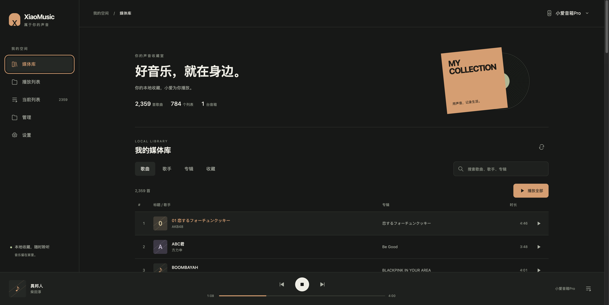
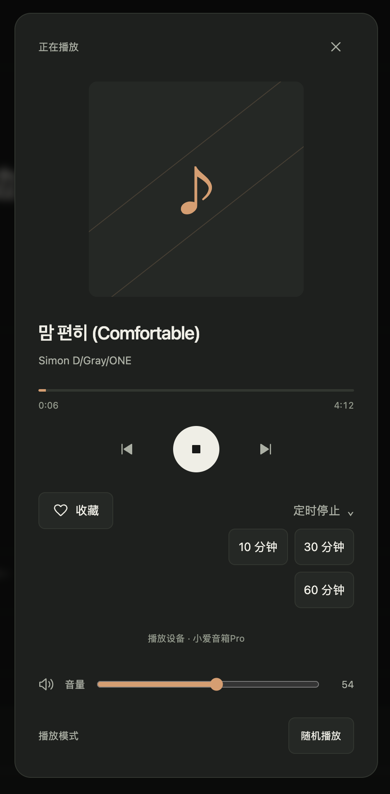

# XiaoMusic · 本地媒体维护分支

本仓库是 [hanxi/xiaomusic](https://github.com/hanxi/xiaomusic) 的独立维护 fork，由 [jieyujing](https://github.com/jieyujing) 继续开发。上游已公告停止维护；这里的 `main` 是本 fork 的维护主线，不代表上游官方发行版。

目标是通过小爱音箱播放自己的本地媒体，并提供统一、手机优先的管理界面。保留上游作者署名与 MIT 许可证，感谢原作者及贡献者。

## 界面预览

媒体库首页：浏览本地收藏、搜索歌曲，并选择音箱播放。



播放控制：查看当前歌曲，调整音量、播放模式、收藏与定时停止。



## 当前功能

- 本地歌曲搜索、歌手／专辑浏览、收藏、目录及自定义歌单、歌单排序。
- 音箱选择、播放与停止、音量、播放模式、定时停止、实时播放状态。
- 本地语音点播、繁简／标题匹配、匹配失败时本地随机回退、当前歌曲询问。
- 统一设置页：69 个原有参数、13 个分类，扫码登录、设备选择、维护操作。
- 媒体标签、歌词、封面管理；插件查看／禁用／卸载；历史下载任务管理。
- 认证恢复及脱敏诊断日志。

在线搜索、下载、远程媒体推送与导入保持禁用，相关管理入口展示限制原因。音频由音箱播放，页面不提供浏览器本机播放器。当前列表显示已有列表顺序，不承诺等同于随机播放的下一首顺序。

功能与接口对应关系见 [UI 说明](docs/ui-library.md)和[完整接口清单](docs/ui-route-coverage.md)。

## 部署范围与限制

当前版本针对已验证的 miniFNOS 家庭部署，**尚不是任意环境开箱即用的通用发行版**：

| 项目 | 当前值 |
| --- | --- |
| 媒体根目录 | `/vol2/1000/music` |
| 媒体服务地址 | `http://192.168.100.99:8090` |
| 容器配置目录 | `/app/conf` |
| 媒体挂载 | 只读 |

根目录和媒体来源由 `xiaomusic/local_media.py` 固定，网页设置不能扩大访问范围。迁移到其他主机前需同步修改该文件与 Compose 中的路径、绑定地址，重新构建并验证。不要仅修改网页的 hostname。

媒体卷只读，因此删除磁盘文件、将标签写入原文件会受权限限制；标签缓存仍使用配置卷。语音方案通过读取小米会话接管媒体请求，无法拦截音箱固件的所有云端行为，也不意味着设备完全离线。账号登录及原生语音仍依赖小米服务。

## 从源码构建与运行

需要 Git、Docker Engine 与 Docker Compose 插件。不要使用上游 `latest` 镜像代替本 fork 的构建结果。

```sh
git clone --recurse-submodules https://github.com/jieyujing/xiaomusic.git
cd xiaomusic
git checkout main
docker build -f deploy/Dockerfile.local-media -t xiaomusic:local-media .
```

Dockerfile 基于固定摘要的上游运行环境，加入本仓库应用代码、静态资源与回归测试。构建不需要小米账号，也不会连接音箱。

在目标 NAS 部署目录放置 Compose 文件并创建配置目录；现有安装请先备份 Compose 和 `conf`，保留原镜像以便回退：

```sh
mkdir -p /vol1/1000/DockerData/xiaomusic/conf
cp deploy/minifnos.compose.yaml /vol1/1000/DockerData/xiaomusic/docker-compose.yml
cd /vol1/1000/DockerData/xiaomusic
docker compose up -d --wait
```

前提是目标主机已有 `/vol2/1000/music` 且拥有 `192.168.100.99` 地址。媒体目录不存在时启动失败，不会自动创建空媒体库。打开 `http://192.168.100.99:8090/`，在设置中完成账号登录与音箱选择。已有浏览器标签页需刷新以加载新版界面。

此配置面向可信局域网，不提供公网访问入口；账号、Cookie、认证缓存及诊断文件放在 `conf`，不要提交进 Git。

## 验证

验证阶段沿用生产运行环境并单独安装测试客户端依赖，不挂载生产媒体或配置：

```sh
docker build --target verification -f deploy/Dockerfile.local-media -t xiaomusic:verify .
docker run --rm --network none --entrypoint /app/.venv/bin/python3 \
  xiaomusic:verify -m unittest \
  test.test_local_media test.test_local_matching test.test_voice_playback \
  test.test_qrcode_auth test.test_auth_token_sync test.test_conversation_recovery \
  test.test_auth_diagnostics test.test_ui_contract -q
```

浏览器回归使用隔离的 HTTP/WebSocket fixture，不操作真实音箱：

```sh
npm install --prefix /tmp/xiaomusic-ui-test playwright@1.62.1
/tmp/xiaomusic-ui-test/node_modules/.bin/playwright install chromium
NODE_PATH=/tmp/xiaomusic-ui-test/node_modules node test/ui/library.spec.cjs
```

接口与设置清单审计：

```sh
python3 scripts/audit_ui_routes.py
python3 scripts/generate_settings_schema.py
git diff --exit-code -- xiaomusic/static/library/*schema.json \
  xiaomusic/static/library/route-coverage.json docs/ui-route-coverage.md
```

测试通过表示代码、契约及隔离流程通过；真实音箱出声和媒体文件写入需要另外验收。

## 开发与发布

- `main` 保持可构建；改动通过功能分支和本仓库 PR 合入。
- `Fork verification` 执行镜像构建、后端测试及浏览器回归，无发布凭据要求。
- 继承自上游的 Docker Hub、Pages 和自动格式化工作流改为手动触发；使用前需配置自己的发布目标与凭据。
- 未完成的 Agent 桥接实验不属于当前维护主线。
- 本 fork 暂未发布自己的 Docker Hub / PyPI 包；上游同名包不含这里的改动。

部署行为与故障排查：[本地媒体说明](docs/local-media.md)、[UI 部署与回退记录](docs/ui-deployment-20261022.md)。原项目介绍归档于[上游 README](docs/README-upstream.md)，其中在线功能及旧安装命令不适用于本分支。

## 许可证

[MIT License](LICENSE)。原作者版权与贡献记录保留。
